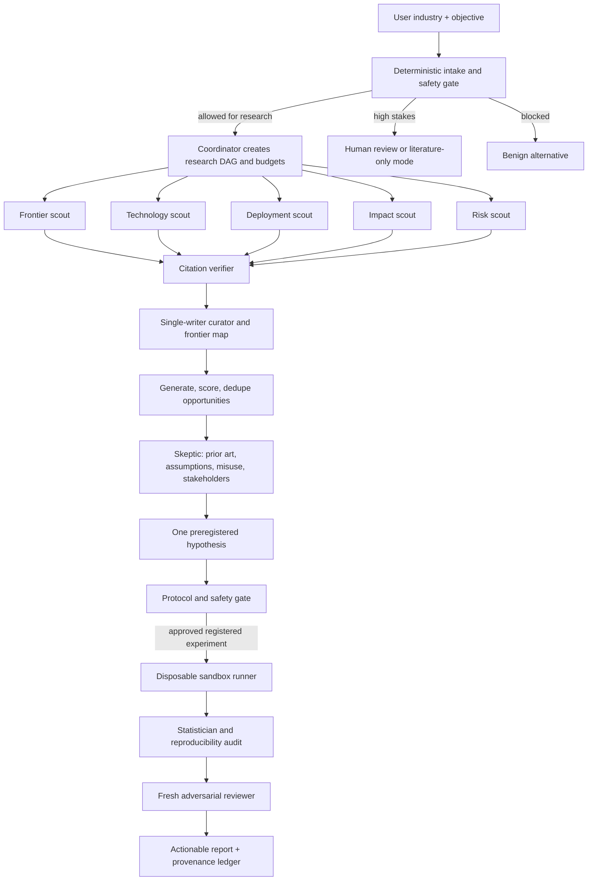

# Architecture

## Outcome

Use a deterministic coordinator around a small number of specialist model agents. Parallelize independent reading, not state mutation. Gate every transition with typed artifacts and keep experiments behind a separate, registered execution boundary.



## Pattern justification

The workflow combines five patterns:

1. **Classify and act** for the initial safety and domain route.
2. **Fan out and synthesize** for breadth-first source discovery, where lanes are independent and context isolation helps.
3. **Adversarial verification** for citations and final scientific claims.
4. **Generate and filter** for candidate gaps, because novelty ideation is cheap but reliable selection is hard.
5. **Evaluator–optimizer with a hard cap** for one revision of the hypothesis or protocol. The system does not use an unbounded self-improvement loop.

This preserves the documented benefits of multi-agent breadth while avoiding conflicting writes and unnecessary token use. A lightweight run may use one research agent with the same artifact contracts; increase worker count only when evals show better coverage.

## Roles and tools

| Role | Owns | Tools | Writes canonical state? |
|---|---|---|---|
| Coordinator | DAG, budgets, lane prompts, stopping | Artifact store, task runner | Yes |
| Scouts | Independent source discovery | Web/search, read-only connectors | No |
| Citation verifier | Claim/source entailment and provenance | Page fetch, file read | No |
| Curator | Deduplication, frontier map | Structured artifact store | Yes |
| Opportunity analyst | Candidate generation and rubric scoring | Calculator, artifact read | Through coordinator |
| Skeptic | Prior art, confounding, safety, stakeholders | Search and artifact read | No |
| Hypothesis designer | One falsifiable hypothesis | Artifact read | Through coordinator |
| Protocol reviewer | Preregistration and safety checks | Schema validator | Through coordinator |
| Runner | Registered experiment only | Sandboxed process | Results directory only |
| Statistician | Effect size, uncertainty, sensitivity | Local analysis tools | Through coordinator |
| Final reviewer | Claim-by-claim downgrade or acceptance | Read-only complete dossier | No |

The model-facing tool set stays small and distinct. Large intermediate results remain in files; agents receive only lane inputs or claim subsets. Source documents never directly control tool selection.

## Durable state

Each run is a directory with append-only events and versioned structured artifacts:

```text
manifest.json
research-plan.json
events.jsonl
evidence.jsonl
opportunities.json
hypotheses.json
experiment-spec.json
experiment-results.json
experiment.log
findings.md
audit.json
```

`manifest.json` records artifact hashes after finalization. `experiment-spec.json` is frozen before execution. Negative results and rejected opportunities remain visible rather than being erased.

## Human checkpoints

- After intake for high-stakes domains or sensitive data.
- Before paid compute, large downloads, or proprietary data access.
- Before enabling any network egress or external side effect in an experiment.
- Before translating a result into healthcare, safety, regulatory, financial, or operational advice.
- Before publication, deployment, or contacting a third party.

## Exit conditions

- Research stops after two consecutive dry rounds, the source budget, or the time/cost budget.
- Citation verification stops when every shortlisted claim has a verdict.
- Opportunity selection stops after one skeptical review and rerank.
- Experimentation stops after one preregistered run plus declared sensitivity and clean reproduction checks.
- The overall run stops as `completed`, `completed_literature_only`, `inconclusive`, `blocked`, or `failed`; it never silently loops forever.

## Production adapters

- **OpenAI:** Responses API when the application owns the loop; Agents SDK when SDK-managed specialists, tracing, guardrails, and resumable approvals are desired. Use sandbox agents or an equivalent controlled compute environment.
- **Anthropic:** Claude Agent SDK or Claude Code subagents for isolated read-heavy lanes; Skills for the reusable procedure and tool guidance.
- **Vercel:** `ToolLoopAgent` for specialist loops, `WorkflowAgent`/Workflow SDK for durable checkpoints and delayed approvals, AI SDK streaming for UI events, and Vercel Sandbox or another microVM provider for execution.

The portable skill and artifact contracts remain provider-neutral; adapters should not weaken the gates.
